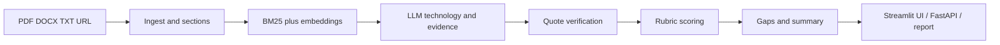

# TRL-Scout

TRL-Scout estimates a technology's Technology Readiness Level from a
technical document. It links the estimate to verified source quotes, shows
what evidence is missing for the next level, and produces an auditable report.

> Screenshot placeholder: add a current UI capture at `docs/screenshot-placeholder.png`
> before public release.

## Quick start

```text
python -m venv .venv
.venv\Scripts\pip install -e ".[dev]"
.venv\Scripts\streamlit run app/streamlit_app.py
```

Without an LLM provider key, the UI opens in deterministic demo mode. Add
values from `.env.example` to `.env` for live assessments.

## Architecture



## How scoring works

The nine-level rubric is the source of truth. Verified evidence is mapped to
criteria, weighted by polarity and attribution, averaged into level scores,
and combined with three independent judge samples. Author-stated TRL mentions
are reported as signals but cannot determine the result on their own.

## Evaluation

| Mode | Exact accuracy | Within +/-1 | MAE | Spearman |
|---|---:|---:|---:|---:|
| Full | TBD | TBD | TBD | TBD |

The bundled rows are invented smoke-test fixtures, not scientific ground truth.

## Limitations

- Results are estimates based on the submitted document only.
- OCR, non-English text, missing sections, and unsupported claims reduce
  confidence.
- Live quality depends on the selected LLM provider and embedding model.
- The system is not a certification or substitute for domain review.

## Technology stack

Python 3.11, FastAPI, Streamlit, Pydantic, PyMuPDF, pdfplumber, Tesseract,
spaCy, BM25, sentence-transformers, LiteLLM, Jinja2, WeasyPrint, and
matplotlib.


See [deployment instructions](docs/deploy.md) and the detailed
[project documentation](docs/README.md).
